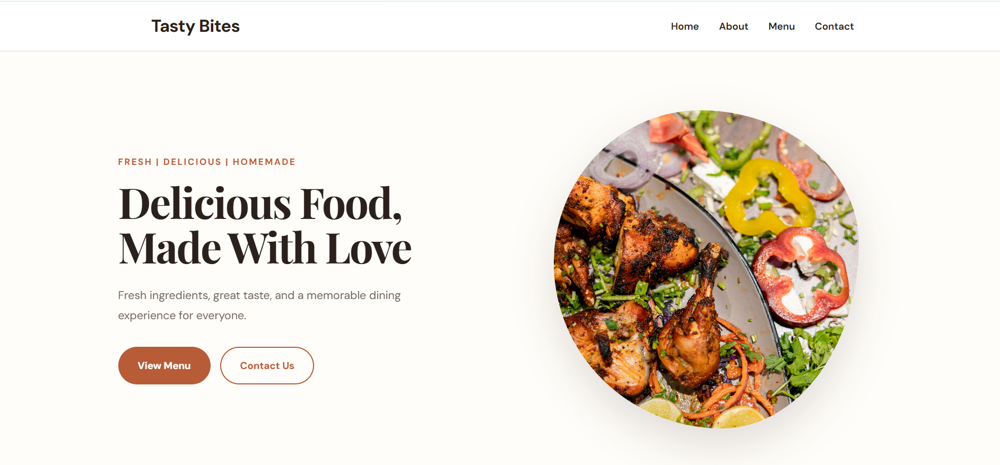
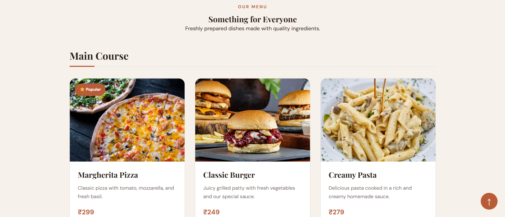
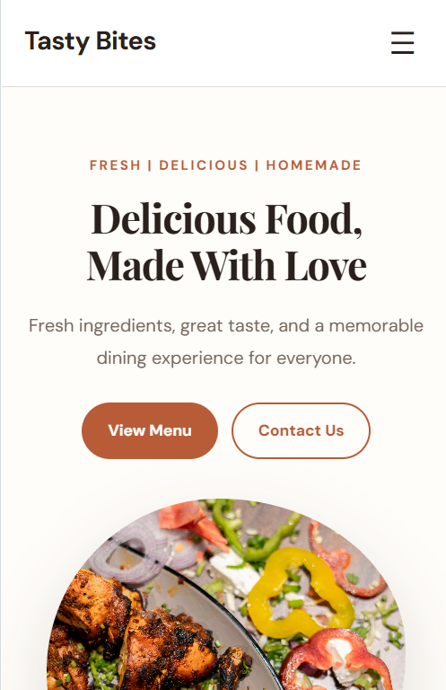

# 🍽️ Tasty Bites – Restaurant Website

A modern, responsive restaurant website built using HTML, CSS, and JavaScript. Tasty Bites showcases delicious food, restaurant information, menu items, opening hours, and a contact section with interactive form validation.

## 🌐 Live Demo

[View Tasty Bites Website](https://carolfernandis.github.io/tasty-bites-restaurant/)

## 📸 Screenshots

### Homepage


### Menu Section


### Mobile View


## ✨ Features

- Responsive design for desktop, tablet, and mobile devices
- Modern navigation bar with mobile hamburger menu
- Attractive hero section
- Restaurant About section
- Food menu cards with hover effects
- Contact information and opening hours
- Contact form with validation and success message
- Smooth scrolling navigation
- Scroll-to-top button
- CSS animations and transitions
- Clean and user-friendly design

## 🛠️ Technologies Used

- HTML5
- CSS3
- JavaScript
- Google Fonts

## 📂 Project Structure

```text
restaurant-website/
├── index.html
├── README.md
├── css/
│   └── style.css
├── js/
│   └── script.js
├── images/
│   └── food images
└── screenshots/
    ├── homepage.png
    ├── menu.png
    └── mobile-view.png
```

## 💻 Run Locally

1. Clone this repository:

   ```bash
   git clone https://github.com/CarolFernandis/tasty-bites-restaurant.git
   ```

2. Open the project folder.

3. Open `index.html` in your browser.

## 🎯 Project Purpose

This project was created to practice and improve my frontend web development skills, including HTML structure, CSS styling, responsive design, JavaScript interactions, and website deployment using GitHub Pages.

## 👩‍💻 Author

**Carol Fernandis**

- GitHub: [CarolFernandis](https://github.com/CarolFernandis)

---

⭐ If you like this project, feel free to explore the repository!
